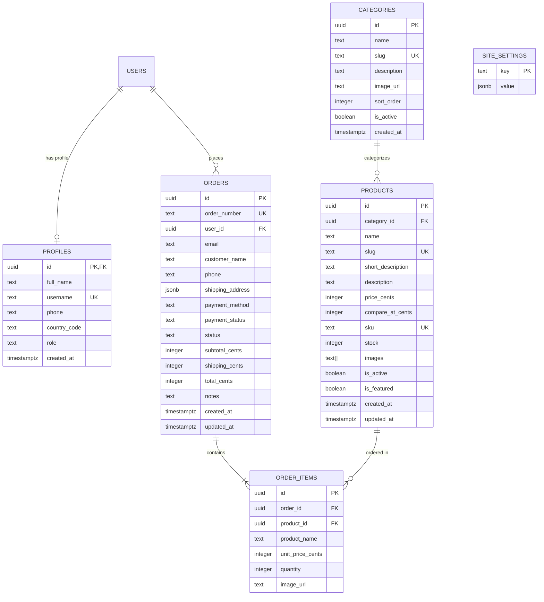
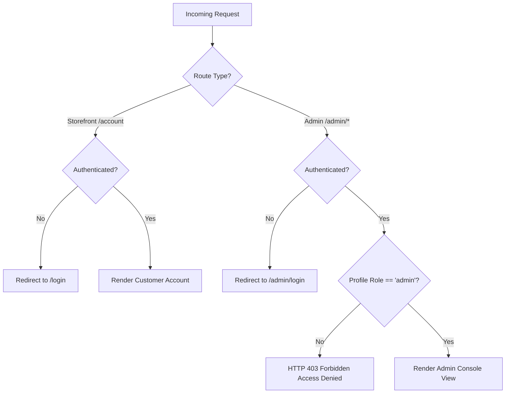

# GlassCart E-Commerce Website: Comprehensive Technical Documentation

---

## 1. Project Overview

### 1.1 Project Title & Identity
* **Project Name:** GlassCart
* **Tagline:** Modern Minimalist Hardware & Audio Storefront
* **System Classification:** Full-Stack Enterprise-Grade Web Application & E-Commerce Management System
* **Academic Context:** Bachelor of Science in Information Technology (BS IT) Capstone / Final Year Software Engineering Project

### 1.2 Purpose & Motivation
Traditional web development projects often rely heavily on monolithic frameworks (such as Laravel, Django, or Spring Boot) that introduce hundreds of hidden third-party dependencies, complex Object-Relational Mappers (ORMs), and heavy server-side overhead. 

**GlassCart** was engineered from first principles as a **zero-dependency, cloud-native PHP 8.3 micro-framework application**. It demonstrates that high performance, cryptographic session security, clean Model-View-Controller (MVC) separation, and modern user experience can be achieved with pure, native technologies coupled with cloud backend-as-a-service (BaaS) infrastructure.

### 1.3 Core Objectives
1. **Zero External Composer Dependencies:** Operate on native PHP 8.3 with zero third-party PHP packages (`vendor/` directory is entirely absent), using only built-in extensions (`curl`, `sodium`, `mbstring`, `json`, `fileinfo`).
2. **Stateless Cloud-Native Architecture:** Eliminate local server disk state. The application runs inside an ephemeral Docker container on Render, storing all persistent data and authentication in Supabase (PostgreSQL), while sessions and shopping carts are stored on the client using authenticated symmetric encryption (`sodium_crypto_secretbox`).
3. **Strict Separation of Administrative and Customer Concourses:** Ensure administrators and customers operate through segregated routes, controllers, and authorization pipelines with database-grounded Role-Based Access Control (RBAC).
4. **Modern UI/UX with Glassmorphism Design Language:** Deliver an aesthetic, accessible, and responsive user interface utilizing translucent CSS backdrop filters, liquid aurora background gradients, dark/light theme switching, and accessibility typography scaling.
5. **Robust Security Posture:** Implement defense-in-depth security, including Libsodium AEAD session security, Content Security Policy (CSP), anti-CSRF token verification, brute-force rate-limiting, and SQL injection immunity via parameterized REST API boundaries and database stored procedures.

### 1.4 Main Implemented Features Summary
* **Customer Storefront:** Dynamic homepage with hero 3D interactive tilt, category navigation, live product catalog with client/server price sliders, keyword search, category filters, responsive product detail pages (PDP) with thumbnail galleries, and stock availability clamping.
* **Persistent Encrypted Shopping Cart:** Real-time mini-cart slide-over drawer, quantity stepper controls, free-shipping threshold tracker ($75.00 limit), and persistent stateless cookie cart.
* **Streamlined Checkout:** Two-step checkout with server-side validation, supporting Cash on Delivery (COD) and Direct Bank Transfer with atomic database stored procedures (`place_order`).
* **Customer Account Portal:** Customer registration, login with auto-confirmed email, OAuth buttons, profile management, and paginated order history with itemized order tracking.
* **Admin Control Center:** Segregated `/admin/login` portal with brute-force lockout, KPI analytics dashboard (gross revenue, orders today, registered customers, inventory health), product CRUD with multi-image upload to Supabase Storage, category management drawer, order status lifecycle management, user management with role toggling, and live store settings editor.
* **Live Customer Engagement Integrations:** Integrated WhatsApp direct live chat widget (`wa.me`) and Elfsight AI conversational chatbot.

---

## 2. Technologies Used

| Layer / Domain | Technology | Version / Specification | Purpose in GlassCart |
| :--- | :--- | :--- | :--- |
| **Server Runtime** | PHP | 8.3.x (Debian-based) | Core backend language; executes controllers, routing, validation, encryption, and API integrations. |
| **Web Server** | Apache HTTP Server | 2.4.x | Reverse proxy, static asset delivery, HTTP gzip compression, and URL rewrites via `mod_rewrite`. |
| **Database Engine** | PostgreSQL (Supabase) | 15.x / 16.x | Relational database engine storing tables, constraints, triggers, indexes, and PL/pgSQL stored procedures. |
| **Authentication Service** | Supabase GoTrue Auth | REST API v1 | Secure identity provider handling user registration, encrypted token issuance, and password recovery. |
| **Cloud Object Storage** | Supabase Storage (S3-compatible) | REST API v1 | Storage of product photography uploaded via admin forms in bucket `product-images`. |
| **Containerization** | Docker | Linux (`php:8.3-apache`) | Encapsulates the entire web application into an immutable container for standardized deployment. |
| **Cloud Hosting** | Render.com | Free Web Service | Production container hosting with automated continuous deployment from GitHub and free Cloudflare SSL. |
| **Cryptographic Library** | Libsodium | Built-in PHP `ext-sodium` | AEAD authenticated encryption (`crypto_secretbox`) for stateless client-side session cookies. |
| **Styling & Design System** | Vanilla CSS3 | Custom Glassmorphism Token Architecture | Design tokens, CSS variables, backdrop-filter glass cards, Flexbox/Grid layouts, and dark mode. |
| **Frontend Scripting** | Vanilla JavaScript | ECMAScript 2020 (ES11) | Client-side DOM manipulation, asynchronous Fetch API, cart drawer, toast notifications, and modal controls. |
| **Version Control** | Git & GitHub | Git 2.x | Distributed source code versioning and automated continuous deployment triggers. |
| **Third-Party Widgets** | Elfsight & Revora | JavaScript CDN / Static SVG | Embedded AI conversational assistant and WhatsApp direct customer communication widget. |

---

## 3. Project Architecture

### 3.1 Architectural Pattern
GlassCart follows a **Modern Headless Model-View-Controller (MVC) and Service-Repository Pattern** adapted for serverless database infrastructure:

```
[ Web Browser Client ]
       |
       | HTTPS Requests (GET, POST) + Encrypted Session Cookie (gc_s)
       v
[ Cloudflare CDN & Reverse Proxy (Render.com) ]
       |
       v
[ Apache 2.4 Web Server ] ---> [ public/index.php (Front Controller) ]
                                          |
                         +----------------+----------------+
                         |                                 |
                         v                                 v
               [ App\Core\Router ]               [ App\Core\Session ]
                         |                    (Decrypts gc_s with Sodium)
                         v
               [ Controller Layer ]
       (Storefront, Auth, Account, Admin)
                         |
                         v
                [ Service Layer ]
     (CartService, CheckoutService, RateLimiter)
                         |
                         v
               [ Repository Layer ]
    (ProductRepo, CategoryRepo, OrderRepo, ProfileRepo)
                         |
                         v
            [ App\Supabase\Client (cURL) ]
                         |
                         | HTTPS REST API (API Key + Service Role)
                         v
            [ Supabase Cloud Backend ]
    +-----------------------------------------------+
    | - PostgreSQL (Tables, Views, PL/pgSQL RPCs)   |
    | - GoTrue Authentication Engine                |
    | - Supabase Storage (product-images bucket)    |
    +-----------------------------------------------+
```

### 3.2 Key Architectural Components

1. **Front Controller (`public/index.php`):**
   * Acts as the single entry point for all HTTP requests.
   * Initializes the PSR-4 autoloader (`src/bootstrap.php`), captures the incoming request into an `App\Core\Request` object, runs routes through `App\Core\Router`, and emits the generated `App\Core\Response`.
2. **Stateless Session Engine (`src/Core/Session.php`):**
   * Unlike traditional PHP sessions that store files on `/tmp` on the server disk, GlassCart stores session state in an encrypted client cookie named `gc_s`.
   * The cookie payload is encrypted using Libsodium authenticated symmetric encryption (`crypto_secretbox`) with a 256-bit key derived from `APP_SECRET`. Tampering with the cookie invalidates the MAC checksum, protecting session integrity.
3. **Repository Layer (`src/Repositories/`):**
   * Abstracts all PostgREST database queries. Controllers never write direct HTTP queries to Supabase; they interact with clean static methods like `ProductRepository::findById()`.
4. **Service Layer (`src/Services/`):**
   * Handles multi-step business logic: `CartService` resolves live product pricing and stock clamping, `CheckoutService` prepares deadlock-free ordered payloads for the database RPC, and `RateLimiter` enforces brute-force attack prevention.
5. **View Engine (`src/Core/View.php`):**
   * Pure PHP templating system utilizing template inheritance with layouts (`views/layouts/main.php`, `views/layouts/admin.php`) and reusable partial components. Output escaping is enforced via `e()` and `ea()` helper functions.

---

## 4. Folder and File Structure

Below is the directory map of the GlassCart workspace:

```
E:\WEB PROJECT\
│
├── .git/                                # Git version control repository
├── .github/                             # GitHub automation workflows (e.g. keepalive)
├── .gitattributes                       # Enforces Linux LF line endings for shell scripts
├── .gitignore                           # Excludes .env, *.log, /gc_cache/, /vendor/
├── .dockerignore                        # Excludes non-production files from Docker build
├── Dockerfile                           # Production container definition (PHP 8.3 + Apache)
├── render.yaml                          # Infrastructure-as-Code blueprint for Render
├── README.md                            # Project overview and quickstart instructions
├── Architecture.md                      # Technical specifications & decisions log
├── Design.md                            # Visual design system specifications
├── PRD.md                               # Product Requirements Document
├── Rules.md                             # Coding standards and architectural constraints
├── Tasks.md                             # Historical backlog and milestone tracking
├── GLASSCART_PROJECT_DOCUMENTATION.md   # This comprehensive technical manual
│
├── database/                            # Database definitions and migration scripts
│   ├── schema.sql                       # Complete PostgreSQL schema, tables, triggers, RPCs
│   ├── seed.sql                         # Default categories, products, and site settings
│   └── make_admin.sql                   # SQL script to promote a user to administrator role
│
├── docker/                              # Container runtime configurations
│   ├── apache.conf                      # Apache VirtualHost listening on $PORT (10000)
│   ├── entrypoint.sh                    # Container startup script replacing port in apache.conf
│   └── php.ini                          # Production PHP directives (display_errors=Off, etc.)
│
├── public/                              # Public Web Root (Exposed to internet)
│   ├── .htaccess                        # Apache URL rewriting fallback
│   ├── index.php                        # Master Front Controller & Route Registry
│   └── assets/                          # Static Frontend Assets
│       ├── css/
│       │   ├── tokens.css               # Design tokens (colors, typography, spacing, radii)
│       │   ├── base.css                 # CSS reset, accessibility styles, typography
│       │   ├── components.css           # Buttons, cards, badges, inputs, drawers, modals
│       │   ├── pages.css                # Page-specific storefront styles (hero, shop, cart)
│       │   └── admin.css                # Modern SaaS admin dashboard styles (100KB+ custom CSS)
│       ├── js/
│       │   ├── theme-init.js            # Blocking script preventing flash of unstyled theme (FOUC)
│       │   ├── ui.js                    # UI interactions (theme toggle, a11y scaling, modals)
│       │   ├── cart.js                  # Asynchronous AJAX cart operations & drawer sync
│       │   └── admin.js                 # Admin UI scripts (drawer, tabs, discount calculator)
│       └── img/
│           ├── favicon.svg              # Browser tab brand icon
│           ├── logo.svg                 # GlassCart translucent brand mark
│           ├── og-default.svg           # Social media OpenGraph preview image
│           ├── placeholder.svg          # Fallback image for missing product media
│           └── products/                # High-resolution optimized photography (.jpg)
│
├── src/                                 # Backend Source Code (PSR-4 App\ Namespace)
│   ├── autoload.php                     # Lightweight zero-dependency PSR-4 class loader
│   ├── bootstrap.php                    # Application initializations, error handlers, CSP headers
│   │
│   ├── Core/                            # Framework Core Engines
│   │   ├── Cache.php                    # In-memory and local disk cache fallback
│   │   ├── Env.php                      # .env configuration reader and parser
│   │   ├── Logger.php                   # Monolog-compatible structured JSON logger
│   │   ├── Request.php                  # HTTP Request abstraction (query, input, files, server)
│   │   ├── Response.php                 # HTTP Response builder (HTML, JSON, Redirect, Headers)
│   │   ├── Router.php                   # URL routing engine with regex matching & middleware
│   │   ├── Session.php                  # Libsodium AEAD encrypted client-side session manager
│   │   ├── Validator.php                # Server-side input validation and error bag
│   │   └── View.php                     # Template rendering engine with layout support
│   │
│   ├── Controllers/                     # Storefront & Customer Controllers
│   │   ├── AccountController.php        # Customer dashboard, profile update, order history
│   │   ├── AuthController.php           # Customer login, register, logout, password recovery
│   │   ├── CartController.php           # Cart view, mini-cart JSON endpoints, add/update/remove
│   │   ├── CheckoutController.php       # Checkout view, order placement, order success
│   │   ├── HealthController.php         # Deployment health monitor and database ping (/health)
│   │   ├── HomeController.php           # Homepage rendering with featured and newest items
│   │   ├── PageController.php           # Static informational pages (About, Terms, Privacy)
│   │   ├── ProductController.php        # Product Detail Page (PDP) and related products
│   │   ├── SeoController.php            # Dynamic sitemap.xml and robots.txt generation
│   │   ├── ShopController.php           # Catalog browsing, filtering, search, and pagination
│   │   │
│   │   └── Admin/                       # Administrator Controllers (Protected by RBAC)
│   │       ├── AdminAuthController.php  # Dedicated admin portal login (/admin/login) & logout
│   │       ├── DashboardController.php  # Admin KPI metrics overview and quick stats
│   │       ├── ProductAdminController.php # Product catalog CRUD and image uploads
│   │       ├── CategoryAdminController.php# Category taxonomy and slide-over drawer
│   │       ├── OrderAdminController.php # Order fulfillment, tracking, and forward lifecycle
│   │       ├── UserAdminController.php  # User management and admin promotion
│   │       └── SettingsAdminController.php# Store settings editor (currency, shipping, notice)
│   │
│   ├── Repositories/                    # Data Access Layer (Supabase PostgREST)
│   │   ├── CategoryRepository.php       # Category queries and administrative mutations
│   │   ├── OrderRepository.php          # Order listings, RPC call execution, status changes
│   │   ├── ProductRepository.php        # Catalog filtering, sorting, search, low-stock alerts
│   │   ├── ProfileRepository.php        # User profile retrieval, username lookups, role checks
│   │   └── SettingsRepository.php       # Site settings key-value pair store
│   │
│   ├── Services/                        # Business Logic Layer
│   │   ├── CartService.php              # Cart hydration, stock validation, and line totals
│   │   ├── CheckoutService.php          # Checkout payload assembly and deadlock-free sorting
│   │   ├── PricingService.php           # Subtotal, shipping threshold, and total calculations
│   │   └── RateLimiter.php              # File-based rate limiter for login brute-force lockout
│   │
│   ├── Supabase/                        # Cloud Infrastructure Client
│   │   ├── Auth.php                     # Supabase GoTrue Auth API wrapper
│   │   ├── Client.php                   # Persistent cURL client for PostgREST endpoints
│   │   └── Storage.php                  # Supabase Object Storage multipart upload handler
│   │
│   └── Support/                         # Global Helper Utilities
│       └── helpers.php                  # e(), url(), asset(), money(), csrf_field(), icon()
│
├── views/                               # Presentation Layer (PHP Templates)
│   ├── layouts/                         # Master Document Shells
│   │   ├── main.php                     # Storefront master layout
│   │   └── admin.php                    # Admin dashboard master layout
│   │
│   ├── partials/                        # Reusable Template Partials
│   │   ├── head-meta.php                # Meta tags, favicons, fonts, stylesheets
│   │   ├── header.php                   # Storefront navigation bar, logo, theme toggle
│   │   ├── footer.php                   # Storefront footer, links, copyright
│   │   ├── flash.php                    # Alert boxes for success and error flash messages
│   │   ├── mini-cart.php                # Slide-over cart drawer body
│   │   ├── product-card.php             # Reusable product grid card component
│   │   ├── pagination.php               # Numbered page navigation links
│   │   ├── cookie-consent.php           # GDPR cookie banner and preferences modal
│   │   ├── whatsapp-widget.php          # Floating WhatsApp direct customer support widget
│   │   └── icons.php                    # Inline SVG icon library generator function
│   │
│   ├── pages/                           # Customer-Facing Page Views
│   │   ├── home.php                     # Homepage with hero section & featured products
│   │   ├── shop.php                     # Catalog page with sidebar filters & search
│   │   ├── product.php                  # Product detail page with gallery and specs
│   │   ├── cart.php                     # Full shopping cart table and order summary
│   │   ├── checkout.php                 # Shipping address and payment method form
│   │   ├── order-success.php            # Order confirmation screen with invoice details
│   │   ├── login.php                    # Customer login form with OAuth buttons
│   │   ├── register.php                 # Customer registration form with password rules
│   │   ├── forgot-password.php          # Password reset request form
│   │   ├── reset-password.php           # New password submission form
│   │   ├── account.php                  # Profile view and update form
│   │   ├── account-orders.php           # Customer past order listing
│   │   ├── order-detail.php             # Customer single order tracking view
│   │   ├── static.php                   # Generic content view for terms, privacy, about
│   │   ├── 403.php                      # Forbidden access view
│   │   ├── 404.php                      # Page not found error view
│   │   ├── 419.php                      # CSRF token expired / page expired error view
│   │   └── 500.php                      # Internal server error friendly view
│   │
│   └── admin/                           # Administrator Dashboard Views
│       ├── login.php                    # Isolated Admin Portal login screen
│       ├── dashboard.php                # KPI metric cards, recent orders, low stock
│       ├── products-index.php           # Product inventory table with filters
│       ├── product-form.php             # Product create/edit SaaS form with discount helper
│       ├── categories.php               # Category table and slide-over drawer
│       ├── orders-index.php             # Order management table with status filtering
│       ├── order-show.php               # Detailed order fulfillment view & transitions
│       ├── users-index.php              # User accounts list with role management
│       ├── user-form.php                # Admin manual user creation & editing form
│       └── settings.php                 # Store settings vertical tabs (shipping, currency)
│
└── scripts/                             # Verification & Automated Testing Suite
    ├── test_auth_separation.php         # 24-point automated test suite for Auth & RBAC
    └── verify_system.php                # 33-point end-to-end regression verification suite
```

---

## 5. Frontend Operations

### 5.1 Design Tokens & Theming (`public/assets/css/tokens.css`)
GlassCart implements a tokenized design system built using CSS Custom Properties:
* **Color Palette:** Primary brand indigo (`#4f46e5`), emerald green (`#10b981`), rose red (`#f43f5e`), and slate gray neutrals.
* **Glassmorphism Scale:**
  * `.glass`: Standard translucency (`backdrop-filter: blur(16px); background: rgba(255,255,255,0.7);`).
  * `.glass--strong`: Elevated translucency for headers and navigation bars.
  * `.glass--subtle`: Light translucency for secondary elements.
* **Theme Switching:** Managed via `data-theme="light"` or `data-theme="dark"` attributes on the root `<html>` element. `theme-init.js` reads `localStorage.getItem('theme')` in the `<head>` before body rendering, preventing Flash of Unstyled Theme (FOUC).

### 5.2 Accessibility Controls (`public/assets/js/ui.js`)
* **Skip Link:** Accessible `<a href="#main-content" class="skip-link">` allows keyboard users to bypass header navigation.
* **Font-Scale Switcher:** Three buttons (`A-`, `A`, `A+`) allow users with visual impairments to dynamically toggle `data-font-scale="sm|md|lg"` on the `<html>` element. The preference is persisted across sessions via `localStorage`.

### 5.3 Asynchronous Cart Drawer (`public/assets/js/cart.js`)
* Adding an item on the storefront intercepts the standard form submission via `fetch('/cart/add', { headers: { 'Accept': 'application/json' } })`.
* If JavaScript is enabled, the cart updates dynamically without a full-page reload, recalculates the subtotal, updates the badge counters, replaces the HTML of `#mini-cart-container`, and opens the right-side slide-over drawer.
* If JavaScript is disabled, the form gracefully falls back to a standard HTTP `POST /cart/add` and redirects to `/cart`.

### 5.4 Slide-Over Drawers & Modals
* **Cart Drawer (`views/layouts/main.php`):** Slides out from the right using CSS transforms with an accessible modal backdrop and `Escape` key listeners.
* **Category Drawer (`views/admin/categories.php` & `public/assets/js/admin.js`):** A slide-over drawer on the admin panel that handles both category creation and editing without navigating away from the table.

---

## 6. Backend Operations

### 6.1 PSR-4 Autoloading Mechanism (`src/autoload.php`)
GlassCart avoids heavy Composer autoloader files by utilizing a native PHP autoloading function registered via `spl_autoload_register`:

```php
spl_autoload_register(static function (string $class): void {
    $prefix = 'App\\';
    if (!str_starts_with($class, $prefix)) {
        return;
    }
    $relative = substr($class, strlen($prefix));
    $file = __DIR__ . '/' . str_replace('\\', '/', $relative) . '.php';
    if (is_file($file)) {
        require_once $file;
    }
});
```

### 6.2 HTTP Request & Response Cycle
* **`App\Core\Request`:** Encapsulates PHP superglobals (`$_GET`, `$_POST`, `$_FILES`, `$_SERVER`, and `php://input`). It provides type-safe accessors such as `int()`, `string()`, `bool()`, `query()`, `header()`, `ip()`, and `wantsJson()`.
* **`App\Core\Response`:** Standardizes output generation with fluent helpers:
  * `Response::html(string $body, int $status = 200)`
  * `Response::json(mixed $data, int $status = 200)`
  * `Response::redirect(string $url, int $status = 302)`
* When `Response::send()` is called, it emits HTTP status codes, headers, encrypted session cookie headers, and the response body before terminating execution.

### 6.3 Routing Engine (`src/Core/Router.php`)
The router compiles declarative path patterns into unified regular expressions:
* `{slug}` compiles to `(?P<slug>[a-z0-9-]+)`
* `{id}` compiles to `(?P<id>[0-9a-fA-F-]{36})` (UUID v4)
* `{number}` compiles to `(?P<number>ORD-\d{6}-[A-Z0-9]{6})`

Matched parameters are extracted from named capture groups and injected directly into `$request->setRouteParams($matchedParams)`.

### 6.4 Middleware Execution Pipeline
Before invoking controller action methods, the router runs assigned middleware filters:
* **`csrf` Middleware:** On state-modifying verbs (`POST`), validates `_csrf` input against the token stored in the encrypted session. Rejects forged requests with HTTP 419.
* **`auth` Middleware:** Verifies customer authentication. Unauthenticated requests are redirected to `/login?next=...`.
* **`guest` Middleware:** Prevents logged-in users from viewing login/registration pages; redirects them to `/account`.
* **`admin` Middleware:** Verifies that the user possesses the `admin` role by checking the database profile. Authenticated customers attempting to access admin routes receive an explicit **HTTP 403 Forbidden**.

---

## 7. Database Design

The database schema is defined in `database/schema.sql` and deployed on PostgreSQL via Supabase.

### 7.1 Entity-Relationship Diagram (ERD)



### 7.2 Database Tables Description

#### 1. `public.profiles`
Stores extended user profile information linked to Supabase Auth (`auth.users`).
* `id` (`UUID`, Primary Key, Foreign Key to `auth.users(id)` ON DELETE CASCADE)
* `full_name` (`TEXT`): User's legal name.
* `username` (`TEXT`, Unique): Alphanumeric unique handle.
* `phone` (`TEXT`): Customer contact number.
* `country_code` (`TEXT`, Default `'+1'`): Dialing prefix.
* `role` (`TEXT`, Not Null, Default `'customer'`, Check: `role in ('customer', 'admin')`): Role authorization tag.
* `created_at` (`TIMESTAMPTZ`, Default `now()`).

#### 2. `public.categories`
Product taxonomy groupings for store browsing and navigation.
* `id` (`UUID`, Primary Key, Default `gen_random_uuid()`).
* `name` (`TEXT`, Not Null): Display name (e.g. "Audio").
* `slug` (`TEXT`, Not Null, Unique): URL-friendly string (e.g. "audio").
* `description` (`TEXT`): Category marketing summary.
* `image_url` (`TEXT`): Header or banner imagery.
* `sort_order` (`INTEGER`, Default `0`): Manual priority for navigation placement.
* `is_active` (`BOOLEAN`, Default `true`): Visibility switch.

#### 3. `public.products`
The core catalog inventory table.
* `id` (`UUID`, Primary Key, Default `gen_random_uuid()`).
* `category_id` (`UUID`, Foreign Key to `categories(id)` ON DELETE SET NULL).
* `name` (`TEXT`, Not Null): Title of the item.
* `slug` (`TEXT`, Not Null, Unique): URL slug (e.g. "aura-one-wireless-headphones").
* `short_description` (`TEXT`): Subtitle shown on cards.
* `description` (`TEXT`): Full HTML/Markdown description shown on PDP.
* `price_cents` (`INTEGER`, Not Null, Check `>= 0`): Stored as an integer in cents (e.g., $249.00 = `24900`) to avoid floating-point rounding errors.
* `compare_at_cents` (`INTEGER`, Nullable): Original price for showing discount badges.
* `sku` (`TEXT`, Unique): Inventory tracking code.
* `stock` (`INTEGER`, Not Null, Default `0`, Check `>= 0`): Live stock quantity.
* `images` (`TEXT[]`, Not Null, Default `'{}'`): Array of image URLs.
* `is_active` (`BOOLEAN`, Default `true`): Storefront visibility toggle.
* `is_featured` (`BOOLEAN`, Default `false`): Highlight on homepage.
* `created_at` / `updated_at` (`TIMESTAMPTZ`).

#### 4. `public.orders`
Master sales transaction records.
* `id` (`UUID`, Primary Key, Default `gen_random_uuid()`).
* `order_number` (`TEXT`, Not Null, Unique): Human-readable identifier (e.g. `ORD-261124-AB12CD`).
* `user_id` (`UUID`, Foreign Key to `auth.users(id)` ON DELETE SET NULL). Nullable for guest checkout.
* `email` (`TEXT`, Not Null): Customer contact email.
* `customer_name` (`TEXT`, Not Null): Recipient name.
* `phone` (`TEXT`, Not Null): Delivery phone number.
* `shipping_address` (`JSONB`, Not Null): Structured JSON containing street, city, state, postal code, and country.
* `payment_method` (`TEXT`, Check `in ('cod', 'bank_transfer')`).
* `payment_status` (`TEXT`, Check `in ('pending', 'paid', 'failed', 'refunded')`).
* `status` (`TEXT`, Check `in ('pending', 'confirmed', 'shipped', 'delivered', 'cancelled')`).
* `subtotal_cents` / `shipping_cents` / `total_cents` (`INTEGER`, Not Null).
* `notes` (`TEXT`): Optional delivery instructions.

#### 5. `public.order_items`
Itemized line-item snapshot associated with an order.
* `id` (`UUID`, Primary Key).
* `order_id` (`UUID`, Foreign Key to `orders(id)` ON DELETE CASCADE).
* `product_id` (`UUID`, Foreign Key to `products(id)` ON DELETE SET NULL).
* `product_name` (`TEXT`): Snapshot of name at the time of purchase.
* `unit_price_cents` (`INTEGER`): Price locked at time of order.
* `quantity` (`INTEGER`, Check `> 0`).
* `image_url` (`TEXT`): Snapshot thumbnail URL.

#### 6. `public.site_settings`
Global key-value configuration table.
* `key` (`TEXT`, Primary Key): Parameter name (e.g. `free_shipping_threshold_cents`, `store_name`).
* `value` (`JSONB`, Not Null): Configuration payload.

### 7.3 Database Stored Procedures (PL/pgSQL)

#### `place_order(...)`
An atomic stored procedure executed using database transaction semantics to guarantee stock reservation and prevent race conditions:
1. Validates that `$p_items` is non-empty.
2. Generates a unique order number (`ORD-YYMMDD-XXXXXX`).
3. Inserts the parent record into `orders`.
4. Loops through each line item, locking the product row with `SELECT ... FOR UPDATE`.
5. Verifies that `is_active` is true and available `stock >= quantity`. If insufficient, throws `OUT_OF_STOCK:<name>`.
6. Decrements product inventory: `UPDATE products SET stock = stock - qty`.
7. Inserts the line item into `order_items` and accumulates `subtotal_cents`.
8. Calculates `total_cents = subtotal_cents + shipping_cents` and updates the order.
9. Returns `order_id`, `order_number`, and `total_cents` as JSON.

#### `cancel_order(p_order_id UUID)`
Atomically cancels an order and restores product inventory:
1. Locks the order record (`FOR UPDATE`) and validates that status is `pending` or `confirmed`.
2. Restores inventory for all line items: `UPDATE products SET stock = stock + oi.quantity FROM order_items oi ...`.
3. Sets order status to `'cancelled'`.

#### `admin_stats()`
Aggregates dashboard metrics in a single database query:
* `orders_today`: Count of orders created since `date_trunc('day', now())`.
* `pending_orders`: Count of unfulfilled orders.
* `revenue_30d_cents`: Sum of non-cancelled orders over the last 30 days.
* `low_stock`: Count of active products with `stock <= 5`.
* `products_total`: Total catalog inventory count.

---

## 8. Authentication and Authorization

### 8.1 Complete Separation of Customer and Admin Authentication
Per security specifications, the administrative login is completely isolated from customer portals:
* **Customer Authentication Portal:** Located at `/login` and `/register`. Customers enter credentials and are redirected to `/account`. Customer registration forces `role = 'customer'` and does not offer any role selection inputs.
* **Admin Authentication Portal:** Located at dedicated `/admin/login`. Admin links are completely excluded from customer navigation headers, footers, and profile pages.
* **Strict RBAC Enforcement:** When a logged-in user with the `customer` role attempts to access `/admin` or any `/admin/*` route, the router re-checks their role from the database and returns **HTTP 403 Forbidden**, rendering `views/pages/403.php`.



### 8.2 Customer Authentication Flow (`src/Controllers/AuthController.php`)
1. **Registration:**
   * Validates `full_name` (alphabets only), `email`, `password` (minimum 6 characters), and confirmation.
   * Calls `App\Supabase\Auth::register()`, which creates the identity in Supabase GoTrue with `email_confirm = true` and auto-provisions a `profiles` row with `role = 'customer'`.
   * Automatically initializes the session and redirects the user to `/account`.
2. **Login:**
   * Accepts either email address or username (`identifier`).
   * Evaluates brute-force lockout via `RateLimiter::tooManyAttempts()`.
   * Resolves username to email via `ProfileRepository::findByUsername()` if an alphanumeric identifier is supplied.
   * Calls Supabase `auth/v1/token?grant_type=password`.
   * On success, establishes session credentials (`uid`, `email`, `name`, `role`) and redirects to `$next` (sanitized to prevent redirecting customers to `/admin`).
3. **Password Recovery:**
   * Customer enters their email on `/forgot-password`.
   * `AuthController::sendPasswordReset()` invokes Supabase `auth/v1/recover`.
   * Recovery link directs customer to `/reset-password` where `AuthController::updatePassword()` calls the Supabase Admin API to securely update the password hash.

---

## 9. Admin Dashboard

The administrator dashboard is accessed through `/admin` and styled in `public/assets/css/admin.css` using a modern SaaS layout.

```
+---------------------------------------------------------------------------------------+
|  GlassCart Admin Console                       [Search Inventory...]  (System Admin)  |
+---------------------+-----------------------------------------------------------------+
|  [DASHBOARD]        |  OVERVIEW & METRICS                                             |
|  - Overview         |  +---------------+ +---------------+ +---------------+          |
|  - Analytics        |  | Gross Revenue | | Orders Today  | | Customers     |          |
|                     |  |  $12,450.00   | |      14       | |      128      |          |
|  [CATALOG]          |  +---------------+ +---------------+ +---------------+          |
|  - Products         |                                                                 |
|  - Categories       |  RECENT TRANSACTIONS TABLE                                      |
|                     |  Order #    Customer         Date         Total     Status      |
|  [SALES]            |  ORD-261... Sarah Connor     10 mins ago  $249.00   [Confirmed] |
|  - Orders           |  ORD-261... Alex Morgan      1 hour ago   $99.00    [Pending]   |
|                     |                                                                 |
|  [SYSTEM]           |  LOW STOCK WATCH                                                |
|  - Users & Access   |  - Apex Performance Fitness Ring (0 in stock - Sold Out)        |
|  - Store Settings   |  - Horizon Linear Desk Lamp (2 in stock - Critical)             |
+---------------------+-----------------------------------------------------------------+
```

### 9.1 Dashboard Overview (`DashboardController.php`)
* **KPI Metric Cards:** Displays Gross Revenue (30-day sum), Orders Today, Pending Orders requiring fulfillment, Registered Customer Count, and Inventory Health.
* **Recent Orders Table:** Summarizes the 8 most recent customer orders with badges for payment and fulfillment statuses.
* **Low Stock Alerts:** Highlights products with stock levels `<= 5` units to facilitate replenishment.

### 9.2 Product Management (`ProductAdminController.php`)
* **Listing (`/admin/products`):** Paginated table with thumbnail previews, live price, stock count, active/inactive badges, category filters, and search.
* **Quick Toggle:** Asynchronous one-click activation/deactivation of products via `POST /admin/products/{id}/toggle`.
* **Editor Form (`/admin/products/new` & `/admin/products/{id}/edit`):** Two-column form with automatic slug generation, image upload to Supabase Storage, and a live **Discount Calculator** that automatically computes percentage savings from `compare_at_cents`.

### 9.3 Category Management (`CategoryAdminController.php`)
* **Slide-over Drawer:** Allows adding and editing categories via a slide-over panel on the right side of the screen without leaving the category list.
* **Auto-Slug Generator:** Converts category names to URL-safe slugs in real time.
* **Display Priority:** Configurable `sort_order` controls placement in the storefront top navigation menu.

### 9.4 Order Management (`OrderAdminController.php`)
* **Order Index (`/admin/orders`):** Tabbed views for filtering orders by status (`pending`, `confirmed`, `shipped`, `delivered`, `cancelled`).
* **Order Fulfillment View (`/admin/orders/{number}`):** Detailed invoice view displaying customer contact information, shipping address, order items snapshot, and audit timestamps.
* **Status Transitions:** Enforces valid lifecycle status transitions (`pending` -> `confirmed` -> `shipped` -> `delivered`).
* **Order Cancellation:** Cancelling an order triggers `cancel_order` RPC, which restores inventory in the database.

### 9.5 User Management & RBAC (`UserAdminController.php`)
* **User Directory (`/admin/users`):** Displays all registered profiles with email, phone, role badge, and creation date.
* **Role Toggling:** Administrators can promote customers to administrators or demote accounts with a single click (`POST /admin/users/{id}/role`). Self-demotion is guarded against to prevent accidental lockout.

### 9.6 Store Settings (`SettingsAdminController.php`)
* **Vertical Sidebar Tabs:** Organized into General Info, Payments, Shipping, and Notifications tabs.
* **Live Configuration:** Updates free shipping threshold, flat shipping fee, store name, contact email, top announcement bar text, and bank transfer payment instructions.

---

## 10. Customer Features

### 10.1 Product Discovery & Browsing
* **Dynamic Search & Filtering (`ShopController.php`):** Customers can search items by title/description, filter by category slug, filter by minimum and maximum price, and sort results by 4 modes: `newest`, `price-asc`, `price-desc`, and `name`.
* **Stock Badging:** Real-time visual tags for `-17%` discount badges, `Sold Out` badges for zero stock, and `Only X left` urgency indicators.

### 10.2 Shopping Cart Experience (`CartController.php` & `CartService.php`)
* **Persistent Stateless Cart:** Stored inside the encrypted `gc_s` cookie. Does not require database table writes for anonymous shopping sessions.
* **Stock & Line Clamping:** When opening the cart, `CartService::items()` validates all items against the database. If a product was deactivated or purchased by another user, the cart purges or clamps quantities automatically.
* **Free Shipping Tracker:** Visual progress bar informing the customer: *"Add $26.00 more to unlock Free Shipping!"*

### 10.3 Checkout Experience (`CheckoutController.php` & `CheckoutService.php`)
* **Customer Details Collection:** Captures customer name, email, 11-digit phone number, delivery address, payment method, and special delivery notes.
* **Supported Payment Methods:**
  1. **Cash on Delivery (COD):** Order confirmed immediately; payment marked `pending` until physical delivery.
  2. **Direct Bank Transfer:** Displays banking instructions and bank details saved in `site_settings`. Payment remains `pending` until administrator confirms wire receipt.
* **Post-Order Guard:** Upon successful placement, `CheckoutService` clears the cart and saves `last_order` in the session. The confirmation screen (`/order/success/{number}`) verifies this token to prevent unauthenticated access.

---

## 11. Important Functions and Algorithms

### 11.1 Session Encryption Algorithm (`Session::encrypt` & `Session::decrypt`)
* **File:** `src/Core/Session.php`
* **Algorithm:** AEAD authenticated symmetric encryption using `XChaCha20-Poly1305` (`sodium_crypto_secretbox`).
* **Mechanism:**
  1. Derives a 256-bit binary key from `APP_SECRET` using `sodium_crypto_generichash()`.
  2. Generates a random 24-byte cryptographic nonce using `random_bytes(24)`.
  3. Encrypts the JSON payload with `sodium_crypto_secretbox($json, $nonce, $key)`.
  4. Prepends the 24-byte nonce to the ciphertext and encodes the string using URL-safe Base64 (`base64UrlEncode`).
  5. Decryption splits the nonce from ciphertext, decrypts via `sodium_crypto_secretbox_open()`, and verifies MAC authenticity. If tampered with, decryption returns `null` and initializes an empty session.

### 11.2 Brute-Force Rate Limiting Algorithm (`RateLimiter`)
* **File:** `src/Services/RateLimiter.php`
* **Algorithm:** Sliding Window with Exponential Lockout.
* **Mechanism:**
  1. Computes a cache key based on client IP and login identifier: `'admin_login_' . md5($ip . '_' . strtolower($identifier))`.
  2. Tracks attempt count, timestamp of first attempt, and lockout timestamp in local temporary files (`rl_<sha1>.json`).
  3. After 5 failed attempts within 900 seconds (15 minutes), sets `locked_until = time() + 900`.
  4. `tooManyAttempts()` returns `true`, triggering an immediate **HTTP 429 Too Many Requests** response with minutes remaining.
  5. On successful authentication, `RateLimiter::clear($key)` deletes the tracking file.

### 11.3 Deadlock-Free Inventory Sorting Algorithm
* **File:** `src/Services/CheckoutService.php`
* **Mechanism:** When multiple customers order overlapping items simultaneously, database row locking (`SELECT ... FOR UPDATE`) can result in database deadlocks if transactions acquire locks in different orders. `CheckoutService::process()` prevents this by sorting the order items lexicographically by `product_id` before passing them to the database RPC:
  ```php
  usort($items, static fn($a, $b) => strcmp($a['product_id'], $b['product_id']));
  ```
  Because all concurrent transactions acquire row locks in the identical order, deadlocks are mathematically impossible.

### 11.4 Output Escaping Helpers (`e()` and `ea()`)
* **File:** `src/Support/helpers.php`
* **Mechanism:** Prevents Cross-Site Scripting (XSS) by sanitizing dynamic strings:
  ```php
  function e(mixed $value): string {
      return htmlspecialchars((string)($value ?? ''), ENT_QUOTES | ENT_SUBSTITUTE, 'UTF-8');
  }
  ```

---

## 12. Security Implementation

GlassCart was built following the **OWASP Top 10** web application security guidelines:

| Security Measure | Implementation Mechanism | Protecting Against |
| :--- | :--- | :--- |
| **CSRF Protection** | 64-character hex tokens generated in `Session`, embedded in forms via `csrf_field()`, validated in `Router` middleware. | Cross-Site Request Forgery (CSRF) |
| **XSS Prevention** | Strict HTML entity escaping via `e()` helper across all templates. | Stored & Reflected Cross-Site Scripting |
| **Content Security Policy (CSP)** | Enforced in `src/bootstrap.php`: restricts scripts, frames, and styles to verified origins (`self`, Supabase, Elfsight). | Malicious script injection & clickjacking |
| **Frame Protection** | `X-Frame-Options: DENY` and CSP `frame-ancestors 'none'`. | UI Redressing & Clickjacking |
| **SQL Injection Immunity** | Complete avoidance of raw concatenated SQL strings. All queries execute via PostgREST parameterized queries or PostgreSQL stored procedures with parameterized arguments. | SQL Injection (SQLi) |
| **Brute-Force Protection** | IP and identifier rate limiting (`RateLimiter.php`) locking login forms after 5 failed attempts for 15 minutes. | Credential stuffing & dictionary attacks |
| **Role-Based Access Control** | Double-layer verification in `Router` and `AdminAuthController` querying `profiles.role` from the database. | Privilege escalation & URL manipulation |
| **Session Cookie Hardening** | `gc_s` cookie issued with `HttpOnly`, `SameSite=Lax`, and `Secure` (when running over HTTPS). | Session hijacking & cookie theft |
| **Input Validation & Sanitization** | `Validator.php` enforces strict regex patterns (e.g., `alpha_spaces` for full names, exactly 11 digits for phones, `regex:/^[a-z0-9-]+$/` for slugs). | Malformed input and buffer/parameter pollution |

---

## 13. Third-Party Integrations

### 13.1 Supabase Cloud Integration
* **Connection Architecture:** Server-side HTTPS REST requests executed via PHP `cURL` inside `App\Supabase\Client`.
* **API Credentials:** Utilizes `SUPABASE_PUBLISHABLE_KEY` (anon) for public token grants and `SUPABASE_SECRET_KEY` (service_role) for administrative backend operations.
* **Storage Integration (`src/Supabase/Storage.php`):** Multipart form-data image uploads stream directly to the Supabase `product-images` storage bucket, returning public CDN URLs for catalog display.

### 13.2 Elfsight AI Chatbot
* **Purpose:** Provides interactive automated customer assistance on storefront pages.
* **Embedded Files:** `views/layouts/main.php`.
* **Snippet Details:**
  ```html
  <script src="https://elfsightcdn.com/platform.js" async></script>
  <div class="elfsight-app-b88fa5ae-6b55-4839-9f95-72bf026a2089" data-elfsight-app-lazy></div>
  ```
* **CSP Accommodation:** Whitelisted `https://elfsightcdn.com` and `https://*.elfsight.com` in `src/bootstrap.php` for `script-src`, `connect-src`, and `frame-src`.

### 13.3 WhatsApp Live Chat Widget
* **Purpose:** Instant one-click direct communication channel to store support representatives via WhatsApp.
* **Embedded Files:** `views/partials/whatsapp-widget.php`, included globally in `views/layouts/main.php`.
* **Positioning:** Fixed on the **bottom-left** of the screen (`bottom: 20px; left: 20px`), balancing with the Elfsight chatbot on the bottom-right.
* **Direct Link:** `https://wa.me/923236701030?text=Hi!%20I%20have%20a%20question%20about%20your%20products.`.

---

## 14. Data Flow

### 14.1 Order Placement End-to-End Data Flow

```
[ User Browser ]
       |
       | 1. Submits Checkout Form (POST /checkout + CSRF + Address)
       v
[ Apache / public/index.php ]
       |
       | 2. Captures Request & Dispatches to Router
       v
[ App\Core\Router ]
       |
       | 3. Verifies CSRF Token via Session Middleware
       v
[ CheckoutController::place() ]
       |
       | 4. Validates Form Input (Full name, phone, address, payment method)
       v
[ CheckoutService::process() ]
       |
       | 5. Hydrates cart, clamps stock, sorts items by product_id
       v
[ OrderRepository::createViaRpc() ]
       |
       | 6. Sends HTTPS POST to Supabase /rest/v1/rpc/place_order
       v
[ PostgreSQL Stored Procedure: place_order() ]
       |
       | 7. Locks products row (SELECT FOR UPDATE)
       | 8. Verifies stock and active state
       | 9. Decrements product inventory (stock = stock - qty)
       | 10. Inserts orders row & order_items rows
       | 11. Returns order_number and total_cents
       v
[ CheckoutService::process() ]
       |
       | 12. Empties Session Cart & Sets last_order = ORD-XXXXXX
       v
[ CheckoutController::place() ]
       |
       | 13. Returns 302 Redirect to /order/success/{order_number}
       v
[ User Browser ]
       |
       | 14. Displays Order Confirmation Screen & Invoice Summary
```

---

## 15. Important Operations Step-by-Step

### 15.1 Adding a Product to Cart
1. User clicks **Add to Cart** on a product card or product detail page.
2. `public/assets/js/cart.js` intercepts the form and fires an asynchronous `POST /cart/add` with `Accept: application/json` and `X-CSRF-Token`.
3. `CartController::add()` calls `CartService::add($productId, $qty)`.
4. `CartService` fetches the product from `ProductRepository::findById()`, verifies `is_active` is true and available `stock > 0`.
5. The product ID and clamped quantity are appended to `Session::cart()`.
6. `Session::setCart()` recalculates the encrypted cookie size and commits it.
7. `CartController` responds with JSON containing updated count, total, and mini-cart HTML.
8. `cart.js` updates badge counts in the navbar, updates the slide-out drawer body, and opens the drawer.

### 15.2 Product Creation by Administrator
1. Admin logs into `/admin/login` and navigates to `/admin/products/new`.
2. Admin enters title, category, price ($), compare-at price ($), stock quantity, and selects image files.
3. Form submits `POST /admin/products` with multipart form data.
4. `ProductAdminController::store()` validates fields via `Validator::make()`.
5. For each uploaded image, `App\Supabase\Storage::upload()` verifies MIME type (`image/jpeg`, `image/png`, `image/webp`), generates a sanitized unique filename, and uploads it to the Supabase `product-images` bucket via cURL.
6. The product payload (with price in cents: `(int)round($price * 100)`) is inserted via `ProductRepository::create()`.
7. Admin is redirected to `/admin/products` with a green flash alert.

---

## 16. Deployment

### 16.1 Hosting Infrastructure (Render.com)
The live production application is deployed on **Render** as a free Docker Web Service.
* **Live Storefront URL:** `https://glass-cart.onrender.com`
* **Health Check Endpoint:** `https://glass-cart.onrender.com/health` (Render automated uptime monitor)
* **Deep Health Check:** `https://glass-cart.onrender.com/health?deep=1` (Pings Supabase database)

### 16.2 Environment Variables Configuration
Production configuration is managed via environment variables (never committed to Git):

| Variable Name | Required | Example / Description |
| :--- | :--- | :--- |
| `APP_ENV` | Yes | `production` (enables strict SSL peer verification). |
| `APP_URL` | Yes | `https://glass-cart.onrender.com` (used for canonical tags and reset links). |
| `APP_SECRET` | Yes | 64-character hexadecimal key (32 bytes) for Sodium AEAD encryption. |
| `SUPABASE_URL` | Yes | `https://<project-ref>.supabase.co` |
| `SUPABASE_PUBLISHABLE_KEY` | Yes | Supabase `anon` / public key used for client authentication tokens. |
| `SUPABASE_SECRET_KEY` | Yes | Supabase `service_role` secret key used for administrative database queries. |
| `SUPABASE_STORAGE_BUCKET`| No | Default: `product-images` (storage bucket for catalog imagery). |

### 16.3 Container Configuration (`Dockerfile`)
```dockerfile
FROM php:8.3-apache
RUN a2enmod rewrite headers expires deflate
COPY docker/apache.conf /etc/apache2/sites-available/000-default.conf
COPY docker/php.ini /usr/local/etc/php/conf.d/app.ini
COPY docker/entrypoint.sh /usr/local/bin/app-entrypoint
RUN sed -i 's/\r$//' /usr/local/bin/app-entrypoint && chmod +x /usr/local/bin/app-entrypoint
WORKDIR /var/www/html
COPY . /var/www/html
RUN chown -R www-data:www-data /var/www/html
EXPOSE 10000
ENTRYPOINT ["app-entrypoint"]
CMD ["apache2-foreground"]
```

---

## 17. Testing and Error Handling

### 17.1 Automated Verification Test Suites

#### 1. Authentication Separation Verification (`scripts/test_auth_separation.php`)
A 24-point automated test suite verifying isolation between customer and administrative surfaces:
* Customer surface isolation (no admin links on storefront, no role input on register).
* Unauthenticated redirection (all `/admin/*` routes redirect to `/admin/login`).
* Admin login UI requirements (branding, toggle password, CSRF).
* Role-based access control (customers accessing `/admin` receive HTTP 403 Forbidden).
* Redirect sanitization (prevents malicious open redirects).
* Authorized administrative session verification (HTTP 200).

#### 2. System Verification Suite (`scripts/verify_system.php`)
A 33-point end-to-end regression testing script:
* Storefront & security headers (CSP, X-Frame-Options, X-Content-Type-Options).
* Accessibility features (font scaling, cookie banner, theme init).
* Auth & password recovery forms.
* Admin modules accessibility (Products, Categories, Orders, Users, Settings).
* `RateLimiter` unit logic (attempts, block thresholds, decay times, clearance).

### 17.2 Error Handling & User Feedback
* **User-Friendly Error Pages:** Handled by `src/bootstrap.php` global exception handlers, rendering `views/pages/404.php`, `views/pages/403.php`, `views/pages/419.php`, and `views/pages/500.php`.
* **Detailed Context Logging:** In production (`APP_ENV=production`), raw database or server error traces are suppressed from the client and written to stderr/logs via `App\Core\Logger` in structured JSON format:
  ```json
  {"timestamp":"2026-11-23T20:45:00Z","level":"ERROR","message":"...","context":{...}}
  ```

---

## 18. Implemented vs Missing Features

To maintain academic honesty and clarity in project presentations, below is an objective matrix distinguishing completed, partially implemented, and future functionality:

| Feature Domain | Feature Name | Implementation Status | Technical Details |
| :--- | :--- | :--- | :--- |
| **Catalog** | Product Browsing & Filtering | **Completed (100%)** | Categories, price sliders, keyword search, sorting. |
| **Catalog** | Product Detail Pages (PDP) | **Completed (100%)** | Gallery, stock badges, related products. |
| **Cart** | Client-Side Encrypted Cart | **Completed (100%)** | Mini-cart drawer, quantity controls, auto-clamping. |
| **Checkout** | Cash on Delivery (COD) | **Completed (100%)** | Fully functional with atomic RPC stock decrement. |
| **Checkout** | Direct Bank Transfer | **Completed (100%)** | Displays store banking instructions and generates pending order. |
| **Checkout** | Credit Card (Stripe Gateway)| *Unimplemented* | Payment method dropdown only offers COD & Bank Transfer. |
| **Auth** | Customer Registration & Login | **Completed (100%)** | Form validation, auto-confirmed email, session. |
| **Auth** | Password Reset via Email | **Completed (100%)** | GoTrue `/recover` and admin password update. |
| **Auth** | Social OAuth (Google / FB) | *Partially Implemented* | UI buttons and `/auth/oauth/{provider}` controller endpoints exist; requires user to register OAuth credentials in Supabase Dashboard. |
| **Admin** | KPI Analytics Dashboard | **Completed (100%)** | Gross revenue, orders today, low stock, customer count. |
| **Admin** | Product Catalog CRUD | **Completed (100%)** | Creation, image upload to Supabase, editing, toggling. |
| **Admin** | Category Slide-Over Drawer | **Completed (100%)** | Modern slide-over panel with auto-slug generation. |
| **Admin** | Order Fulfillment Lifecycle | **Completed (100%)** | Status forward progression (`pending` -> `delivered`) & stock-restoring cancellation. |
| **Admin** | User Management & Roles | **Completed (100%)** | Directory, search, and admin promotion/demotion. |
| **Admin** | Store Settings Management | **Completed (100%)** | Vertical sidebar tabs for shipping, announcements, store details. |
| **Support** | WhatsApp Chat Widget | **Completed (100%)** | Fixed bottom-left widget with direct messaging link. |
| **Support** | AI Chatbot Widget | **Completed (100%)** | Fixed bottom-right Elfsight AI conversational bot. |
| **Customer** | Wishlist Functionality | *Unimplemented* | Architecture supports it; wishlist table not created. |

---

## 19. System Requirements

### 19.1 Server / Deployment Environment
* **Operating System:** Linux (Debian 12 Bookworm or Alpine Linux recommended) or Windows 10/11 with Docker Desktop.
* **PHP Version:** PHP 8.3 or higher.
* **Mandatory PHP Extensions:**
  * `ext-sodium` (for AEAD session encryption)
  * `ext-curl` (for Supabase REST communication)
  * `ext-json` (for payload parsing)
  * `ext-mbstring` (for UTF-8 string manipulation)
  * `ext-fileinfo` (for MIME-type image verification)
* **Web Server:** Apache 2.4+ with `mod_rewrite`, `mod_headers`, `mod_deflate`, and `mod_expires` enabled (or Nginx configured with `try_files $uri $uri/ /index.php?$query_string`).
* **Memory & CPU:** Minimum 512 MB RAM, 0.5 vCPU (runs within free tier allocations).

### 19.2 Client Browser Compatibility
* **Supported Browsers:** Google Chrome (v90+), Mozilla Firefox (v90+), Apple Safari (v14+), Microsoft Edge (v90+).
* **JavaScript:** Enabled for AJAX mini-cart updates and slide-over drawers (core browsing and purchasing gracefully function without JS).
* **Cookies:** Cookies enabled (required for `gc_s` session and cart persistence).

---

## 20. Future Improvements

Based on the existing codebase architecture, the following extensions are recommended for future academic semesters or production commercialization:

1. **Integrated Stripe / PayPal Webhooks:** Connect real-time automated payment gateways using Webhook endpoints (`/webhook/stripe`) to transition orders to `paid` automatically.
2. **Persistent Customer Wishlist:** Introduce a `public.wishlists` table linked to `profiles(id)` and `products(id)` to allow customers to save favorite hardware for later purchase.
3. **Automated Order Tracking Email Notifications:** Integrate Resend or SendGrid to dispatch branded HTML confirmation receipts and tracking tracking tracking numbers whenever an order transitions to `shipped`.
4. **Product Variant Management:** Extend `public.products` to support attribute matrixes (e.g. Color: Matte Black, Silver; Cable Length: 1m, 2m) with individual SKU stock tracking.
5. **Customer Product Reviews & Ratings:** Add a verified buyer review table (`public.reviews`) with five-star ratings and photo uploads.
6. **Multi-Currency Support:** Integrate an automated exchange rate API to allow customers outside the United States to browse prices in EUR, GBP, or PKR.

---

*Documentation compiled and verified against GlassCart codebase commit `2102f40`.*
